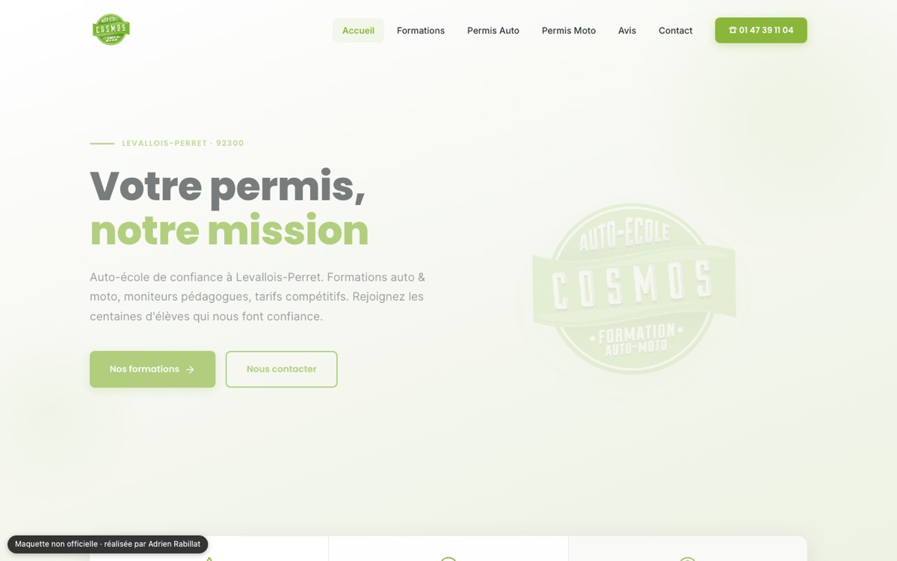

# Maquette — Auto-école Cosmos (Levallois-Perret)

Proposition de refonte du site d'une auto-école. **Maquette non officielle**, réalisée de ma propre initiative : le site n'est pas indexé par les moteurs de recherche.

**Démo** : https://maquette-auto-ecole-cosmos.vercel.app



Six pages (accueil, formations, permis auto, permis moto, avis, contact), balises SEO par page et données structurées JSON-LD.

Stack : React 18, React Router, Framer Motion (Create React App).

## Lancer en local

```bash
# 1. Installer les dépendances
npm install

# 2. Lancer en mode développement
npm start

# 3. Compiler pour la production
npm run build
```

## Structure du projet

```
cosmos-site/
├── public/
│   ├── index.html          # HTML principal (SEO, JSON-LD)
│   ├── robots.txt          # Directives pour les moteurs de recherche
│   └── sitemap.xml         # Plan du site
├── src/
│   ├── components/
│   │   ├── Navbar.js       # Navigation responsive
│   │   ├── Footer.js       # Pied de page
│   │   ├── SEOHead.js      # Balises meta SEO par page
│   │   ├── SectionTitle.js # Titres de section réutilisables
│   │   ├── ReviewCard.js   # Carte d'avis client
│   │   └── FormuleCard.js  # Carte de formule/tarif
│   ├── pages/
│   │   ├── HomePage.js     # Page d'accueil
│   │   ├── FormationsPage.js  # Toutes les formations
│   │   ├── PermisAutoPage.js  # Permis B détaillé
│   │   ├── PermisMotoPage.js  # Permis Moto A2 détaillé
│   │   ├── AvisPage.js       # Tous les avis clients
│   │   └── ContactPage.js    # Contact, horaires, plan
│   ├── styles/
│   │   └── globals.css     # Styles globaux & variables CSS
│   ├── App.js              # Routeur principal
│   └── index.js            # Point d'entrée
└── package.json
```

## Identité visuelle

Couleurs extraites directement de la devanture Cosmos :
- **Vert néon** : `#10b010` (couleur principale du logo)
- **Charcoal** : `#2c2d2d` (façade de l'agence)
- **Noir profond** : `#0a0a0a` (arrière-plan)
- **Off-white** : `#e1dcda` (texte clair)

Typographies :
- **Orbitron** — Titres (réfère au style futuriste/spatial du nom "Cosmos")
- **Outfit** — Corps de texte (moderne et lisible)

## Pages

1. **Accueil** — Hero, statistiques, aperçu formations, avis, CTA
2. **Formations** — Catalogue complet (Auto, Moto, Code)
3. **Permis Auto** — Détails permis B, formules, étapes
4. **Permis Moto** — Détails permis A2, formules 125cc
5. **Avis** — Tous les avis Google avec filtres
6. **Contact** — Formulaire, coordonnées, horaires, plan

## SEO

- Balises meta Open Graph & Twitter Card
- Données structurées JSON-LD (DrivingSchool)
- Sitemap XML
- Robots.txt
- Balises canoniques par page
- Données géographiques (geo meta tags)
